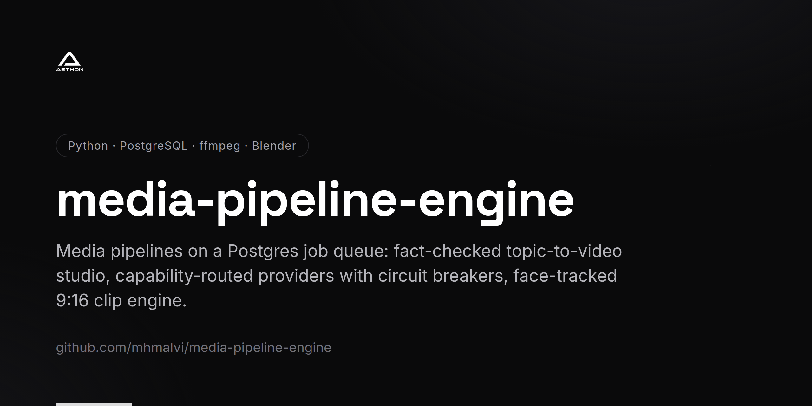
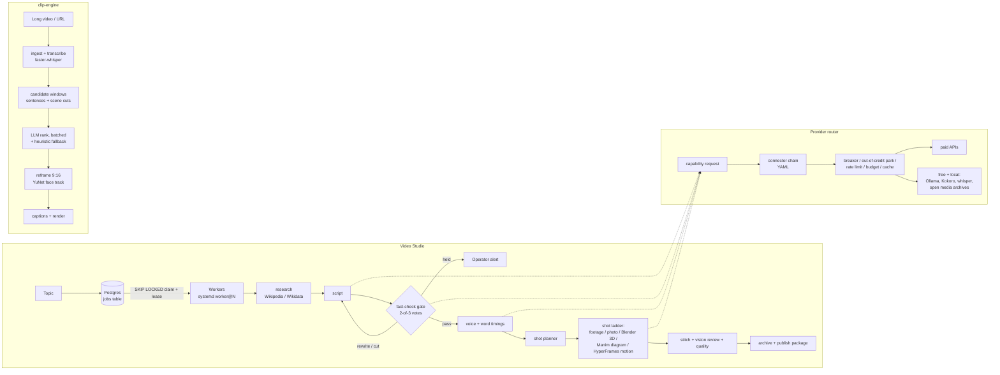

<!-- repo-card -->


# media-pipeline-engine

Self-hosted media pipelines that turn a topic into a fact-checked, rendered documentary video, and a long
recording into ranked, captioned 9:16 clips. Every step is a crash-safe job, and providers are picked by
capability so the work carries on when a paid API runs dry.

Status: running on a self-hosted server since November 2026 (worker pool as systemd template units plus an
hourly production timer); long-form pilot acceptance is still in progress.

This repo is a showcase. The full source is private; `excerpts/` holds sanitized, trimmed copies of the
interesting parts.

## Problem

Making faceless documentary-style videos means chaining a dozen slow, failure-prone steps: research,
scripting, narration, footage search, motion graphics, 3D shots, rendering, stitching and archiving. Each
step depends on third-party APIs whose credit, rate limits and uptime change daily. The server is a single
home box that loses power now and then. A wrong fact that gets voiced and rendered wastes the whole render
and can hurt the channel. So the pipeline has to survive crashes without paying twice, keep going on free or
local providers when paid ones fail, and refuse to voice claims its sources don't support. The same box
also needed a tool to cut long talking-head and screen recordings into vertical clips for short-form feeds.

## Architecture



- **Job queue.** Every pipeline step is a row in a Postgres `jobs` table. Workers claim with
  `FOR UPDATE SKIP LOCKED`, hold a renewable lease, retry with exponential backoff, and are fenced on the
  attempt number so a late result from a lost lease changes nothing.
- **Provider router.** Stages ask for a capability (`text.script`, `voice.narrate`, `footage.search`, ...).
  A YAML file maps each capability to an ordered connector chain. The router skips disabled, parked,
  over-cap or over-budget connectors, takes a shared rate-limit token, checks a cross-process circuit
  breaker, calls, validates, caches by request hash and logs cost.
- **Fact-check gate.** Sits between script and voice. Claims are extracted, judged against the stored
  research passages only, re-voted over fresh source pulls when vote 1 fails, and confirmed failures are
  rewritten from their cited passage or cut. A script that still fails is held for a human.
- **Shot ladder.** Each shot of a scene is filled from on-topic footage, a photo, a headless Blender hero
  shot, a Manim diagram or a HyperFrames (HTML/GSAP) motion template. Each engine runs as a subprocess with
  its own timeout and falls back down the ladder on failure.
- **Voice first.** Narration word timings define the timeline. Scene lengths are frame-aligned, so redoing
  one scene's voice re-renders only that scene.
- **clip-engine.** A separate CLI: ingest (yt-dlp or a local file), transcribe, cut candidate windows on
  sentence boundaries and scene cuts, rank them, reframe to 9:16 (face track, activity crop, centre or
  blur-pad by preset), burn captions, render.
- **motion-lab.** Brand motion films rendered in headless Blender (EEVEE), with a small mixer that renders
  sound effects from a local bank and places their peaks on picture cue frames before loudness
  normalisation.

## Hard engineering decisions

### 1. Postgres is the job queue; no Redis

**Decision.** Jobs live in the same Postgres database as videos, scenes, assets and costs. Enqueue is
`INSERT ... ON CONFLICT (idempotency_key) DO NOTHING`. Claim is `SELECT ... FOR UPDATE SKIP LOCKED` plus an
`UPDATE` that sets a lease. Every result-reporting call (`complete`, `fail`, `heartbeat`) carries a
`WHERE status='running' AND attempts = <my attempt>` fence. A sweeper requeues jobs whose lease expired.
A daemon thread renews the lease on its own connection while a long render runs.

**Why.** The box takes power cuts. With the queue in the same database, job state, video state and events
commit together, and there is no second service to run or back up. Idempotency keys mean a stage that fans
out (one render per shot) can be re-run after a crash without duplicate work or duplicate spend. The
attempt fence closes the classic lease race: a worker that stalled past its lease and finishes late cannot
overwrite the result of the attempt that replaced it.

**Trade-off.** Workers poll instead of being pushed to. Postgres is a single point of failure for the
whole studio. Throughput is bounded by the database rather than a broker, which doesn't matter when one
job is a minutes-long render.

### 2. Capability routing with a shared circuit breaker, and out-of-credit parked separately from flakiness

**Decision.** Stages never import a vendor SDK. The router walks a connector chain per capability, with
free or local connectors in every chain. Breaker state lives in a `provider_health` table, so all worker
processes share it. After the cooldown, exactly one caller across processes wins the half-open probe via a
conditional `UPDATE ... RETURNING`. Failures are classified before they touch the breaker:
- an empty search answer is a normal outcome;
- an unusable reply is an error but not a breaker failure;
- a paid job that fails after the provider accepted it *does* count, so an outage stops costing money;
- an out-of-credit reply (HTTP 402, provider JSON `code: 402`, credit wording, or billing wording on a
  non-429 4xx) parks the provider for hours without counting a failure, with one operator alert a day.

**Why.** In practice, paid API credit ran out mid-build more than once, and one gateway alias silently
fell back to a small local model that returned empty JSON. Counting "out of credit" as flakiness would
re-probe a provider that cannot succeed until someone tops it up. Counting "no results" as a fault would
open the circuit on a perfectly healthy search API.

**Trade-off.** Classification is regex-based and anchored on how each connector formats its errors, so a
new connector has to follow that format. The rate-limit token is taken before the breaker is asked, so a
refused call still spends a token. That is a documented choice to keep the probe claim right next to the
call.

### 3. A fact-check gate that votes, then rewrites or cuts

**Decision.** Before any narration is generated, every checkable claim is judged only against the stored
research passages; the judge's own knowledge does not count. A claim that fails vote 1 gets vote 2 over a
fresh source pull with a different seed. If votes 1 and 2 disagree, vote 3 decides. A claim fails only on
2 of 3. Each confirmed failure is either REWRITTEN (restated from its cited passage) or CUT. It is cut
when no failing vote cited a passage, when its scene was already rewritten once, or when this is the last
allowed repair. Later passes re-check only the scenes that changed and carry the rest forward.

**Why.** A single LLM judge flips on borderline claims, and with one vote and one rewrite the gate held
long scripts on claims a re-check would have accepted. Voting removes most of the flip noise without trusting any one judgment. The REWRITE/CUT rule
guarantees the loop terminates: a claim the sources can't support is removed rather than reworded forever.

**Trade-off.** Extra judge calls on every failed claim. True facts that the fetched passages don't state
get cut, so scripts can come out shorter than planned. A long script can still end up held, which needs a
human.

### 4. A shot ladder of render engines, each isolated and allowed to fail

**Decision.** Each shot is filled by the best available engine: licensed footage or photos from open
archives, headless Blender for 3D hero shots, Manim for diagrams, HyperFrames for HTML/GSAP motion
templates. The LLM fills only JSON data that is schema-checked, never HTML or scene code. Each engine runs
as a subprocess under a hard per-shot deadline; Blender and Manim also get a secret-free environment and
their own process group, so a timeout kills the whole tree.
Blender tries GPU engines first and only when enough VRAM is free. Every engine falls back down the ladder,
ending in a Ken Burns move, never a black frame.

**Why.** Static text cards made early videos look cheap, stock 3D footage is rare and often badly
licensed, and paid generators depended on credit that kept running out. Engine choice was licence-driven:
HyperFrames (Apache-2.0) over Remotion, whose company licence needs a paid tier past a small headcount.
Blender is GPL and is only run as a program, never linked or shipped.

**Trade-off.** Several toolchains to keep working on one box. Manim's native wheels had to be built in a
throwaway Docker container, and HyperFrames needs a different Node major than the system default. Render
time is far higher than with stills.

### 5. Face-tracked reframing on CPU, with one crop command per sample

**Decision.** clip-engine detects faces with YuNet (OpenCV Zoo, Apache-2.0) on CPU, not YOLO and not on the
GPU. Face centres are area-weighted, so the foreground speaker wins over a background face. Missed
detections are filled by carrying the last centre forward instead of being dropped. The crop is clamped to
the detected *content* rectangle, not the frame, and its movement per sample is rate-limited.

**Why.** Ultralytics/YOLO is AGPL-3.0. The small GPU is kept for the local LLM that ranks clips; evicting
it would break ranking. Gap filling fixed a real bug: dropping no-face samples shortened the path, so every
later crop command fired early and the pan drifted out of sync as the clip went on. Clamping to the content
rectangle stops letterboxed screen recordings from cropping their black bars in and scaling them up.

**Trade-off.** CPU detection is slower than GPU detection, so frames are sampled at a low rate and smoothed
instead of detected every frame. Fast subject movement is followed with a lag.

### 6. LLM clip ranking that degrades per batch and never mixes score scales

**Decision.** Candidate windows go to the LLM in small batches through a local-first routing layer. A batch
that times out is halved and each half is tried once. Candidates the model skipped, or that still failed,
are scored by a deterministic heuristic: hook words and their position, a speaking-pace curve,
question/exclamation, concrete numbers, and the strength of the first sentence. The two rankers are merged
by proportional slot allocation, not by sorting on raw score. Every clip's sidecar records which ranker
produced it.

**Why.** One call over all candidates sat right at the routing layer's fixed timeout, which the stage
does not own. LLM and heuristic scores are on different scales: sorting them together would not degrade a
failed batch, it would erase it, because no heuristic score could outrank an LLM score. A partial LLM
answer used to make the unanswered candidates vanish silently.

**Trade-off.** More LLM calls per video. A mixed run's output order interleaves the two rankers by rank
rather than by a comparable score. The heuristic is crude; on conversational transcripts, hook words and
numbers do most of the separating.

## Results

- The studio runs the whole pipeline unattended on short videos, from topic to archived MP4 with captions,
  credits and a publishing package, plus native 9:16 shorts re-cut from the shot assets rather than
  cropped.
- Out-of-credit parking has been exercised for real. A full smoke video was produced while the paid text
  and image providers were out of credit or unconfigured, served entirely by the fallback connectors (a
  CLI-subscription LLM, Kokoro TTS, whisper alignment, open media archives, a local vision model).
- The fact-check gate catches contradicted claims before narration. It has held videos for review instead
  of voicing claims its sources don't support, and the voting and REWRITE/CUT changes let a long pilot
  script pass the gate unattended.
- clip-engine was validated on real footage. Its ranking keeps working with cloud credit exhausted
  because it routes to a local Ollama model first and the heuristic sits underneath.
- No viewer or revenue metrics are claimed here.

## Code excerpts

Run the excerpt tests (stdlib + pytest only; no database, no network):

```bash
python3 -m pytest excerpts -q
```

All of them passed when the command was last run against these excerpts.

| File | What to look at |
|---|---|
| [`excerpts/job_queue.py`](excerpts/job_queue.py) | Idempotent enqueue, `FOR UPDATE SKIP LOCKED` claim, the attempt fence on every result call, backoff in one `UPDATE`, lease recovery and the lease-keeper thread. SQL only, no test. |
| [`excerpts/provider_router.py`](excerpts/provider_router.py) | `is_out_of_credit` (anchored 402 / billing classification), which failures count against the breaker, the cross-process half-open probe claim and the out-of-credit park. |
| [`excerpts/factcheck_gate.py`](excerpts/factcheck_gate.py) | 2-of-3 vote settlement (`confirm`, `_undecided`, `_decided`) and the REWRITE vs CUT rule (`actions`, `_cut_reason`). |
| [`excerpts/facetrack_reframe.py`](excerpts/facetrack_reframe.py) | Area-weighted face centre, gap filling that keeps one crop command per sample, content-rect clamping and rate-limited smoothing. |
| [`excerpts/clip_ranking.py`](excerpts/clip_ranking.py) | Batched LLM ranking, timeout halving, partial answers routed to the heuristic, and `merge_ranked`'s proportional merge across score scales. |
| [`excerpts/rank_heuristic.py`](excerpts/rank_heuristic.py) | The deterministic fallback ranker: five bounded, continuous signals and an explanation of which ones drove each score. |

## Tech stack

- **Core:** Python 3.12, PostgreSQL 16 in Docker, psycopg 3, FastAPI (studio API), React + Vite (studio UI),
  systemd user units and timers.
- **Models and providers:** a LiteLLM gateway, Ollama (local text and vision models), a Claude CLI
  connector, Kokoro TTS, faster-whisper; Wikipedia and Wikidata for fact-check sources.
- **Render:** ffmpeg, headless Blender (OptiX/CUDA/EEVEE), Manim Community, HyperFrames + GSAP on Node 22.
- **clip-engine:** OpenCV (YuNet face detection), PySceneDetect, yt-dlp, auto-editor, faster-whisper.
- **motion-lab:** Blender EEVEE scenes, numpy, soundfile and pyloudnorm for cue mixing and loudness.
- **Tests:** pytest.

## About

Built and operated by Muhammad H.M. Alvi — Founding AI Engineer, Aethon Automation Solutions.
Contact: info@aethonautomation.com · https://github.com/mhmalvi

The full source is private. The files in `excerpts/` are sanitized copies of real modules, trimmed to the
interesting part. Each one's header names the original module and lists what was removed.
